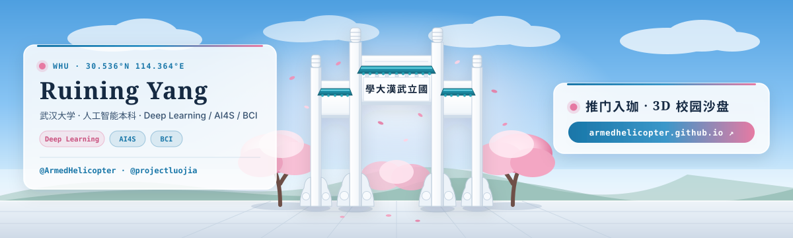

  

<h3 align="center">Ruining Yang · <code>@ArmedHelicopter</code></h3>

  武汉大学人工智能本科生 · <code>@projectluojia</code> · Deep Learning / AI4S / BCI 
  <a href="https://armedhelicopter.github.io/"><strong>→ 推门入珈：打开交互式 HD-2D 武汉大学立体沙盘主页</strong></a>

---

### Research & Systems Highlights

- **[`research-loop`](https://github.com/ArmedHelicopter/research-loop)** — Separation-of-powers protocol for research agents: disjoint proposal, locked execution, and binary audit with label isolation and pre-registered falsifiers.
- **[`ai4s-gate`](https://github.com/ArmedHelicopter/ai4s-gate)** — Host-agnostic AI-for-Science middleware enforcing deterministic skill/tool preconditions across scientific pipelines (`fpocket` → `AutoDock Vina` / `DiffDock`).
- **[`Hankel-Stereo-Purify`](https://github.com/ArmedHelicopter/Hankel-Stereo-Purify)** — Multi-Channel Singular Spectrum Analysis (MSSA) framework for restoring 1950s RCA Living Stereo recordings via zero-copy Block Hankel views and BPW high-band reversible whitening.
- **[`claude-switcher`](https://github.com/ArmedHelicopter/claude-switcher)** — Fail-Closed account environment manager with 11-point fingerprint audit, custom STUN WebRTC leak probe, and Kill-Switch isolation.
- **[`Self-study`](https://armedhelicopter.github.io/Self-study/)** — Interactive scrollytelling essay analyzing the 1881 Tangxu Railway ("马拉火车") and modern AI Agent architectural coupling.

---

### Connect

- Interactive 3D Homepage: **https://armedhelicopter.github.io/**
- Email: `2025302193007@whu.edu.cn`
